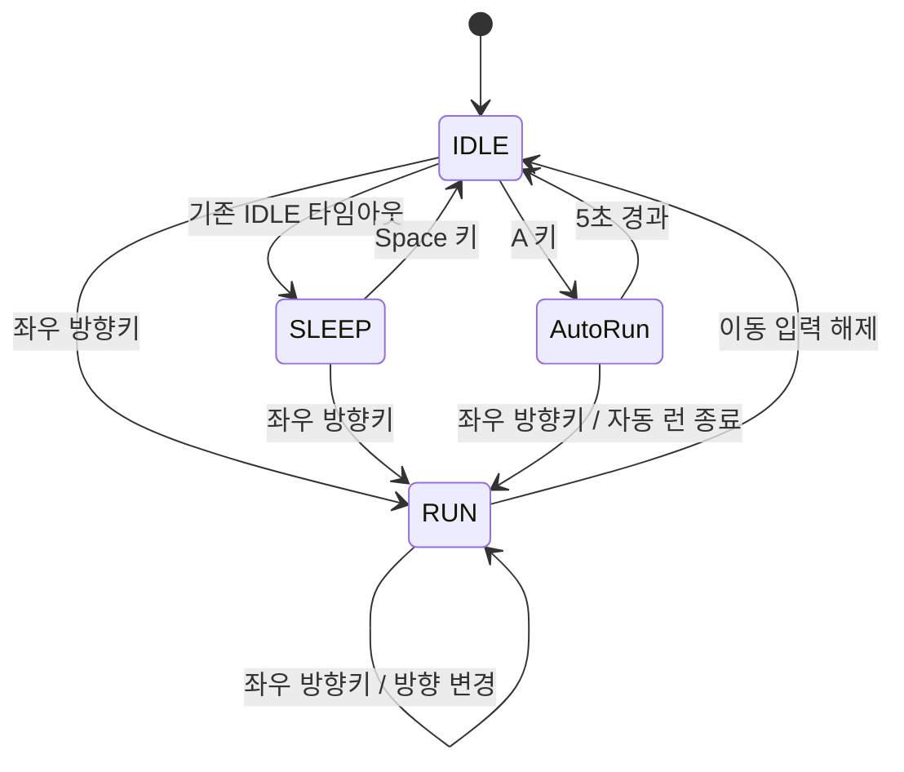

# DRILL-11 자동 런 기능 PRD

## 1. 프로젝트 개요

기존 Pico2D 횡스크롤 캐릭터 예제에 자동 런 상태를 추가한다. IDLE 상태에서 `A` 키를 누르면 소년이 입력 없이 좌우로 달리고, 화면 끝에 도달하면 방향을 바꾼다. 자동 런은 최대 5초 동안 지속되며, 좌우 방향키 입력 또는 시간 만료 시 종료된다.

- 실행 진입점: `main.py`
- 캐릭터 및 상태 동작: `boy.py`
- 배경: `grass.py`, `grass.png`
- 캐릭터 스프라이트: `animation_sheet.png`
- 게임 라이브러리: Pico2D
- 현재 상태: `IDLE`, `RUN`, `SLEEP`
- 추가 상태 클래스: `AutoRun`

## 2. 목표와 범위

### 목표

- IDLE 상태에서 `A` 키로 자동 런을 시작한다.
- 자동 런 중에는 키 입력 없이 계속 이동하고, 기존 달리기 속도의 2배로 움직인다.
- 자동 런 중 캐릭터의 표시 크기를 기존의 1.5배로 한다.
- 화면 좌우 끝에 도달하면 이동 방향을 반전한다.
- 자동 런은 시작 후 5초가 지나면 IDLE로 돌아간다.
- 자동 런 중 좌우 방향키를 누르면 자동 런을 중단하고 해당 입력에 맞는 일반 RUN 동작으로 전환한다.
- 동작을 `AutoRun` 상태 클래스로 구현하고 상태 다이어그램을 DRILL-11 폴더에 저장한다.

### 범위에 포함

- 자동 런 상태의 진입, 갱신, 종료 및 기존 상태 머신과의 연동
- 자동 이동, 화면 경계에서의 방향 반전, 크기 및 속도 배율 적용
- 시간 만료와 사용자 입력에 따른 상태 전환
- 상태 다이어그램 작성 및 저장

### 범위에 포함하지 않음

- 전투, 충돌 판정, 실제 무적 효과, 체력 및 적 캐릭터 추가
- 기존 이미지 리소스나 게임 화면 구성의 전면 변경
- 자동 런 이외의 새로운 게임 상태 및 기능 추가

## 3. 사용자 동작 및 기능 요구사항

### FR-01. 자동 런 시작

- `A` 키를 눌렀을 때 캐릭터가 `IDLE` 상태라면 자동 런 상태로 진입한다.
- `RUN` 또는 `SLEEP` 상태에서 `A` 키를 눌러도 자동 런은 시작하지 않는다.
- 자동 런은 진입 시 캐릭터가 바라보던 방향으로 시작한다.

### FR-02. 자동 이동과 크기

- 자동 런 상태에서는 방향키 입력이 없어도 매 게임 업데이트마다 현재 방향으로 이동한다.
- 이동 속도는 기존 `RUN_SPEED`의 정확히 2배로 적용한다.
- 렌더링 크기는 기존 캐릭터 표시 크기의 가로·세로 각각 1.5배로 적용한다. 원본 스프라이트 크기나 다른 상태의 표시 크기는 변경하지 않는다.
- 크기 배율은 자동 런 상태에서만 적용되며 상태 종료 시 기존 크기로 돌아간다.

### FR-03. 좌우 경계 처리

- 캐릭터의 표시 영역이 좌우 화면 경계에 도달하면 즉시 이동 방향을 반대로 바꾼다.
- 크기가 커진 상태에서도 캐릭터가 화면 밖으로 잘려 나가지 않도록 경계 계산에 확대된 표시 크기를 반영한다.
- 경계에서 캐릭터가 멈추거나 화면 밖으로 나가지 않고 반대 방향 이동을 계속한다.

### FR-04. 자동 런 종료

- 자동 런 진입 시점부터 경과 시간을 측정하고, 5초 이상 지속되면 `IDLE` 상태로 전환한다.
- 자동 런 중 좌우 방향키가 눌리면 자동 런을 즉시 종료한다. 입력된 방향을 일반 RUN 상태에 반영해 기존 이동 및 애니메이션 동작으로 이어간다.
- 어느 종료 경로에서든 확대된 표시 크기와 자동 이동 동작을 해제하고, IDLE 타이머를 새로 시작한다.
- 자동 런의 5초 제한은 프레임 수가 아니라 경과 시간 기준으로 판단한다.

### FR-05. 상태 클래스 및 다이어그램

- 자동 런은 단순히 상태 머신에 문자열 상태를 추가하는 데 그치지 않고 `AutoRun` 상태 클래스로 구현한다.
- `AutoRun` 클래스는 자동 런에 필요한 진입 초기화, 시간 추적, 이동·방향 반전, 종료 처리를 담당하고 기존 상태 전환 흐름과 일관되게 연동한다.
- IDLE, RUN, SLEEP, AutoRun 간 상태 전환과 자동 런의 종료 조건을 나타내는 다이어그램을 작성해 DRILL-11 폴더에 저장한다.

#### AutoRun 상태 클래스 설계 계약

- `AutoRun`은 `transitions.core.State`를 확장하고 기존 `Machine`에 상태 인스턴스로 등록한다. 기존 상태 머신을 다른 라이브러리나 구조로 교체하지 않는다.
- 상태 진입 시 `enter(event_data)`에서 단조 시계를 기준으로 시작 시각을 기록한다. 각 게임 업데이트는 상태 객체의 `update(boy, now)`를 호출해 자동 이동과 애니메이션을 갱신하고, 5초 만료 여부를 결과로 돌려받는다.
- 상태 종료는 상태 객체의 `exit(event_data)` 생명주기와 상태 머신의 전이 후처리를 사용한다. 키 이벤트와 전이 요청은 기존 `Boy` 및 `main.py` 입력 흐름에서 처리한다.
- `Boy`는 일반 상태 전환, 렌더링 및 자동 런 완료 전이를 조정하고, 자동 이동·타이머·경계 반전은 `AutoRun` 상태 객체가 맡는다.

## 4. 상태 전환 다이어그램



## 5. 수용 기준

- [x] IDLE 상태에서 `A` 키를 누르면 자동 런 상태로 진입한다.
- [x] 자동 런 중 입력이 없어도 캐릭터가 바라보는 방향으로 계속 이동한다.
- [x] 자동 런 이동 속도가 기존 RUN 속도의 2배이다.
- [x] 자동 런 중 캐릭터의 렌더링 가로·세로 크기가 기존의 1.5배이며, 종료 후 원래 크기로 복원된다.
- [x] 캐릭터가 확대된 표시 영역을 포함해 좌우 화면 밖으로 나가지 않고, 끝에 닿을 때 방향이 반전된다.
- [x] 자동 런 진입 후 5초 이상 경과하면 IDLE로 전환되며 자동 이동이 중단된다.
- [x] 자동 런 도중 좌우 방향키를 누르면 자동 런이 종료되고 입력 방향의 일반 RUN 애니메이션과 동작으로 이어진다.
- [x] 자동 런 종료 후 IDLE 타이머가 초기화되어 기존 IDLE/SLEEP 동작이 즉시 오동작하지 않는다.
- [x] `AutoRun` 클래스가 구현되어 있으며 실제 자동 런 동작에 사용된다.
- [x] 상태 다이어그램 파일이 DRILL-11 폴더에 저장되어 있고 구현된 전환과 일치한다.
- [x] 기존 IDLE, RUN, SLEEP 전환 및 게임 종료 동작이 유지된다.

## 6. 15단계 점진 개발 및 커밋 계획

각 단계는 앞 단계의 동작을 유지하면서 하나의 작은 변경을 추가한다. 단계별 구현과 해당 단계의 검증을 마친 뒤 그 단계 변경만 커밋한다. 검증이 실패하면 원인을 해결하고 다시 확인하기 전까지 해당 단계는 완료로 표시하거나 커밋하지 않는다.

1. [x] **기존 동작 및 상태 흐름 확인** — `main.py`, `boy.py`, `grass.py`의 이벤트 처리, 상태 머신, 좌표·속도·스프라이트 크기 기준을 확인하고 자동 런이 영향을 주는 기존 동작을 기록한다.
2. [x] **자동 런 상태 설계** — 기존 `transitions.Machine` 사용 방식과 호환되는 `AutoRun` 상태 클래스의 책임 및 진입·업데이트·종료 인터페이스를 정한다. 기존 IDLE, RUN, SLEEP 동작은 변경하지 않는다.
3. [x] **AutoRun 클래스 골격 추가** — 자동 런 상태에 필요한 최소한의 클래스와 연결 지점을 추가하되, 기존 게임 실행 및 상태 전환을 유지한다.
4. [x] **자동 런 진입 연결** — IDLE 상태에서 `A` 키를 누르면 `AutoRun`으로 진입하게 하고, 다른 상태에서는 시작되지 않는지 확인한다.
5. [x] **진입 시 상태 초기화** — 진입 시 시작 시간과 진행 방향을 초기화하고, 자동 런 시작 직후 프레임·방향이 일관되게 표시되는지 확인한다.
6. [x] **자동 이동 구현** — 입력 여부와 관계없이 자동 런 상태에서 캐릭터가 매 업데이트마다 진행 방향으로 움직이게 한다.
7. [x] **속도 배율 적용** — 자동 런에서만 기존 RUN 속도의 정확히 2배를 적용하고 일반 RUN 속도는 유지한다.
8. [x] **크기 배율 적용** — 자동 런 스프라이트의 표시 가로·세로 크기를 각각 1.5배로 만들고, 다른 상태에는 크기 변경이 적용되지 않는지 확인한다.
9. [x] **확대 크기 기준 경계 처리** — 자동 런 중 커진 표시 영역을 기준으로 좌우 이동 한계를 계산하고 화면 끝에서 진행 방향을 반전한다.
10. [x] **5초 자동 종료 구현** — 프레임 수가 아닌 경과 시간으로 자동 런 지속 시간을 측정하고 5초 이상이면 IDLE로 전환한다.
11. [x] **방향키 입력 종료 구현** — 자동 런 중 좌우 방향키 입력 시 즉시 자동 런을 종료하고 입력 방향을 일반 RUN 동작에 전달한다.
12. [x] **종료 상태 복원 및 타이머 초기화** — 시간 만료와 방향키 종료 모두에서 자동 이동과 확대 크기를 해제하고 IDLE 타이머를 초기화한다.
13. [x] **입력·상태 전환 통합 검증** — A 키, 좌우 방향키, 키 해제, 시간 만료의 조합을 확인하고 기존 IDLE/RUN/SLEEP 및 창 종료 동작을 회귀 검증한다.
14. [x] **상태 다이어그램 작성** — 실제 구현에 맞춰 IDLE, RUN, SLEEP, AutoRun 상태 및 전환 조건을 다이어그램으로 작성하고 DRILL-11 폴더에 저장한다.
15. [x] **최종 수용 기준 및 실행 점검** — 문서의 모든 수용 기준과 변경 기능을 확인하고 실행에 필요한 방법 또는 검증 결과를 정리한다.

## 7. 단계별 커밋 규칙

- 위 개발 단계의 구현과 검증이 끝날 때마다 해당 단계 변경만 별도 커밋한다.
- 커밋 제목은 `n. 구현한 내용` 형식으로 작성한다. `n`은 개발 단계 번호(1~15)이며, 제목과 본문은 한국어로 작성한다.
- 커밋 본문에는 단계에서 구현한 내용, 변경 이유, 수행한 검증 및 결과를 구체적으로 기록한다.
- 한 커밋에 서로 다른 단계의 변경을 섞지 않는다. 후속 단계 구현 중 앞 단계의 결함이 발견되면 원인을 해결한 뒤 적절한 단계 커밋에 반영하고 관련 검증을 다시 수행한다.
- 단계의 검증이 실패하면 실패 사실과 원인을 해결하기 전까지 해당 단계 변경을 완료로 커밋하지 않는다.
- 커밋 전에 변경 파일을 확인해 해당 단계와 무관한 작업이나 기존 사용자 변경 사항이 포함되지 않도록 한다.

## 8. 실행 및 최종 검증

Pico2D와 `transitions`가 설치된 Python 환경에서 DRILL-11 폴더를 현재 디렉터리로 두고 실행한다.

```bash
python -m unittest discover -s . -p "test_*.py" -v
python main.py
```

최종 검증은 Python 3.13.2 및 `transitions` 0.9.3 환경에서 수행했다. Pico2D와 `transitions` import, 관련 Python 파일 구문 검사, 자동 런 및 기존 입력 동작을 포함한 unittest 6개가 통과했다. 자동 런의 진입·이동·속도·크기·좌우 경계·5초 종료·방향키 중단과 기존 RUN/SLEEP·종료 입력을 확인했다.
